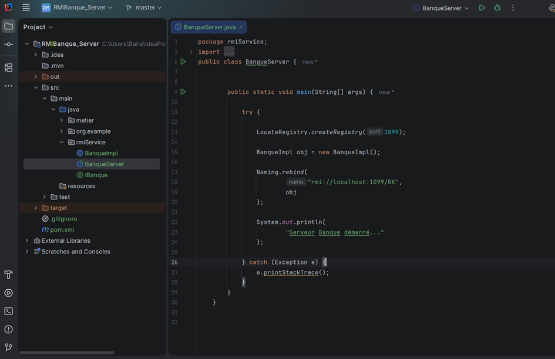
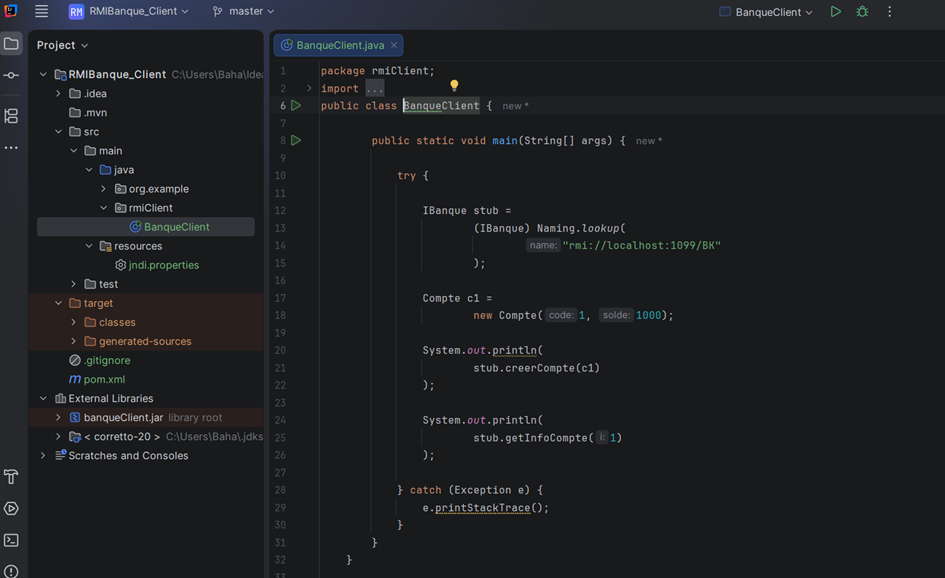

# TP5 : Développement d'un service Banque avec Java RMI

## Structure du projet

### Projet Serveur : RMIBanque_Server

Packages :

- metier
    - Compte.java

- rmiService
    - IBanque.java
    - BanqueImpl.java

- rmiServer
    - BanqueServer.java

---

### Projet Client : RMIBanque_Client

Packages :

- rmiClient
    - BanqueClient.java

Bibliothèque :

- banqueClient.jar

---

## Fonctionnalités réalisées

### Création d'un compte

Le client peut créer un compte bancaire en fournissant :

- un code
- un solde

Exemple :

Code : 1
Solde : 1000

---

### Consultation d'un compte

Le client peut consulter les informations d'un compte à partir de son code.

---

## Captures d'écran

Figure 1 : Projet serveur RMIBanque_Server(avant l'ajout de jndi)

Figure 2 : Projet client RMIBanque_Client(avant l'ajout de jndi)

---

## Exécution

### Lancement du serveur

Exécuter :

BanqueServer.java

Résultat :

Serveur Banque démarré...

---

### Lancement du client

Exécuter :

BanqueClient.java

Le client effectue :

1. Création d'un compte.
2. Consultation du compte créé.

---

## Résultat obtenu

Compte créé avec succès

Compte{
code=1,
solde=1000.0
}

